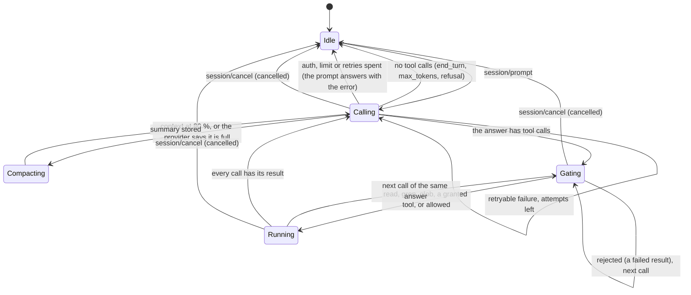

# pard: a minimal ACP coding agent for shed (#2)

## Summary

Decision: pard is one small program that shed starts per lane. A core that knows no provider holds the ACP side, six fixed tools, an append-only session log and two generic model clients; each provider is one config file. The system prompt and tool list never change, so the provider's prompt cache keeps hitting.
Slices: (0) the dependencies alone; (1) conversation shapes and provider files; (2) transport, retries and the OpenAI-format client; (3) the Anthropic client; (4) the six tools; (5) the ACP side and the session log; (6) the turn loop, permissions and usage; (7) compaction and the cache checks. About 3,000 source lines. Then a rerun of the shed#375 task.
Owner decisions (2026-11-24, issue amendment): (1) no Claude subscription login: that provider file stays unwritten and Claude goes through an API key. (2) Keep the `agent-client-protocol` crate; its dependencies land in one dependency-only PR, slice 0, as the one exception to the 10-package gate. (3) One cap raise from 1,500 to 3,400 lines before slice 1. (4) Start the slices now.

## Where things are

The question, the options, each decision with its evidence, the consequences and the `arch.toml` lines:
[adr.md](adr.md). Types, the provider file, the tools, the session log and what shed reads: [shapes.md](shapes.md).
This file has how the callers read, the turn loop's statechart, the ACP methods by module, the module boundaries
and the slices.

## How it reads

### From shed

```console
$ shed run --acp pard --account trial --cwd /home/user/project
$ shed send t1 "Fix the failing test"
$ shed top                      # TOKENS and CACHE for t1
$ shed --json account ls        # the account's spend: tokens and cost this month
```

shed sets `DEEPSEEK_API_KEY` from the account and `PARD_MODEL` from its record, and starts `pard`. pard offers
the models of every provider whose key is in its environment. `shed top`'s `CACHE` and the month's `tokens` come
from the counts pard puts on each prompt response; `TOKENS` and the month's `cost` come from its `usage_update`.
In shed#375 the month's tokens stayed at zero for all three agents, and the cost was one agent's only.

### Adding a provider

One file, no code:

```console
$ cat ~/.local/share/pard/providers/example.toml
name = "Example"
wire = "openai"
base_url = "https://api.example.com/v1"
key_env = "EXAMPLE_API_KEY"
auth = "authorization: Bearer {key}"
[[models]]
id = "example-large"
name = "Example Large"
context = 200000
max_output = 16000
```

### In the code

`main` wires the three crates together and nothing else:

```rust
let catalog = Catalog::load(&home.join("providers"))?;
let sessions = Sessions::open(home.join("sessions"), catalog)?;
acp::serve(sessions, Stdio::new()).await
```

The turn loop is one function. Every way out of it leaves the log a valid conversation:

```rust
pub async fn turn(s: &mut Session, prompt: String, client: &mut impl Client, stop: &Cancel) -> Result<TurnEnd, ModelError> {
    s.push(Item::User(prompt))?;
    for _ in 0..MAX_TURN_REQUESTS {
        if s.context_used() >= s.model().compact_at() {
            compact(s, stop).await?;
        }
        let answer = s.model().call(s.prefix(), s.items(), |delta| client.event(Event::Delta(delta)), stop).await?;
        client.event(s.count(&answer));
        let calls = answer.calls();
        s.push(Item::Assistant(answer.blocks))?;
        if calls.is_empty() {
            return Ok(answer.stop.into());
        }
        let mut results = Vec::new();
        for call in calls {
            results.push(run_call(s, call, client, stop).await);
        }
        s.push(Item::Results(results))?;
        if stop.is_set() {
            return Ok(TurnEnd::Cancelled);
        }
    }
    Ok(TurnEnd::MaxTurnRequests)
}
```

`run_call` parses the arguments, asks permission for `edit`, `write` and `shell`, runs the tool and always
returns a `ToolResult`: a rejected, cancelled, unknown or failed call is a result the model reads, never an error
of the loop.

A test drives the real binary over ACP against a fake provider on localhost that replays recorded streams, and
asserts what shed would see: the updates, the permission requests, the stop reason, the usage.

## The turn loop



- **Idle.** The only state a session hibernates in. A prompt that arrives in any other state waits its turn, in
  order.
- **Calling.** One streamed request. Text and thinking go out as they arrive. A dropped connection, 408, 429,
  5xx or a mid-stream error is tried again up to 6 times with a doubling wait from 1 s, or the provider's
  `retry-after`. A 401 or 403 is never retried.
- **Gating.** `edit`, `write` and `shell` send `session/request_permission` (allow once, always allow this tool,
  reject) unless the session holds a grant for the tool. This is where shed's `--policy` and its judge decide.
- **Running.** One tool at a time, in the order the model asked.
- **Compacting.** One request that asks for a summary. See the ADR, decision 5.
- **Cancel.** Drops the stream, kills the shell's process group, stops waiting on an open permission request,
  writes a `cancelled` result for every call that has none, and answers the running prompt and every waiting one
  with `cancelled`. In the sketch above a cancel during the model call comes back as `ModelError::Cancelled`,
  which `acp` answers as the same stop reason.

What always holds:

1. Before any model call, every tool call in the log has a result.
2. A turn ends only when no process pard started is alive. OpenCode's turn in shed#375 never ended for this
   reason.
3. The system prompt, the tool list and the session's preamble are the same bytes in every request of a session.
4. An item, once sent, is sent again as the same bytes until a compaction.
5. At most 300 model calls per turn; then the turn ends as `max_turn_requests`.

## ACP methods by module

pard uses `agent-client-protocol` `=5.0.0`, the version shed pins, and answers protocol version 1, the one shed
asks for. Only `acp.rs` names its types.

| method | handled in | what happens |
|---|---|---|
| `initialize` | `acp` | Version 1. `loadSession`, `sessionCapabilities.close`. Text prompts only. No MCP transports, no auth methods. |
| `session/new` | `acp` → `store`, `catalog` | Makes the session and its log. Freezes the preamble. Answers the id and the `model` option. Refused with a `pard: auth:` message when no provider key is set, and when MCP servers are passed. |
| `session/load` | `acp` → `store` | Rebuilds the session from its log. Replays nothing: shed shows its own transcript and drops a replay. `_meta` is ignored here, the preamble is the logged one. |
| `session/prompt` | `acp` → `turn` | Runs the loop. Answers the stop reason and the turn's token counts in `_meta`. |
| `session/cancel` | `acp` → `turn` | Sets the session's cancel signal. |
| `session/set_config_option` | `acp` → `store` | The `model` option, between turns. Logged. |
| `session/close` | `acp` → `store` | Cancels, flushes and forgets the session. The log stays until it is 30 days old. |
| `session/update` (sent) | `acp` ← `turn` | `agent_message_chunk`, `agent_thought_chunk`, `tool_call`, `tool_call_update`, `usage_update`. |
| `session/request_permission` (sent) | `acp` ← `turn` | The gate above. |

Not implemented, answered "method not found": `authenticate`, `session/list`, `session/set_mode`,
`session/fork`, `session/resume`. Never called: `fs/*` and `terminal/*`, which shed does not offer.

## Module boundaries

Three crates, so Cargo enforces the arrows.

```
pard (binary)      main, acp, turn, compact, store, usage
  ├── pard-model   types, catalog, http, openai, anthropic      providers/*.toml
  └── pard-tools   read, edit, write, shell, grep, glob
```

- `pard-model` and `pard-tools` depend on neither each other nor the ACP crate.
- In `pard`, only `acp` uses the ACP crate. `turn` talks to it through the `Client` trait in
  [shapes.md](shapes.md), so the loop runs in tests with no ACP and no network.
- In `pard-model`, only `http` starts the transport, and only `catalog` reads provider files and the
  environment. `openai` and `anthropic` are pure: an `encode` from the conversation to a request body and a
  `decode` from stream events to an `Answer`.
- No module outside `catalog` contains a provider's name, URL or header.
- Only `store` writes under `$PARD_HOME`. Only `pard-tools` touches the session's folder.

## Slices

Each is one PR with its tests. The line counts are non-test Rust lines as `ci/cap.toml` counts them.

| # | slice | files | lines |
|---|---|---|---|
| 0 | The dependencies alone: the three crates as empty shells, every dependency with its reason in `.gatekeeper/deps.toml`, the lockfile. No behaviour. The owner's one exception to the 10-package gate. | manifests, `Cargo.lock` | 0 |
| 1 | Shapes and provider files: the types, the catalog, five provider files (deepseek, kimi, glm, openrouter, anthropic). | `pard-model`: `types` 110, `catalog` 220 | 330 |
| 2 | Transport, stream decoding, retries, and the OpenAI-format client, tested on recorded streams. | `http` 240, `openai` 260 | 500 |
| 3 | The Anthropic client with its cache marks and thinking blocks. | `anthropic` 260 | 260 |
| 4 | The six tools. | `pard-tools`: `lib` 140, `read` 80, `edit` 170, `write` 40, `shell` 150, `grep` 120, `glob` 60 | 760 |
| 5 | The ACP side and the session log: new, load, close, the model option. | `pard`: `main` 40, `acp` 390, `store` 170 | 600 |
| 6 | The turn loop, permissions, cancel, usage. The system prompt. | `turn` 350, `usage` 80 | 430 |
| 7 | Compaction, and the checks that keep the cached prefix fixed. | `compact` 120 | 120 |
| | | | **3,000** |

Slices 3 and 4 touch no file of slice 2 and can run beside it. After slice 7, the rerun: shed#375's task, model
and clean room, three runs, scored against the bar in the ADR, decision 8. It spends on the owner's DeepSeek key
(the trial's six runs cost US$0.50), so it is an owner-approved issue of its own.

## Issues to file elsewhere

- **shed:** a built-in record for pard with the lines in [shapes.md](shapes.md), section 6. One record ties an
  agent id to one account provider, so pard on a second provider needs a second record or a new key in the
  record.
- **shed:** shed#375's own follow-ups still stand (the `deepseek` record has no `id`; month spend misses cost).
